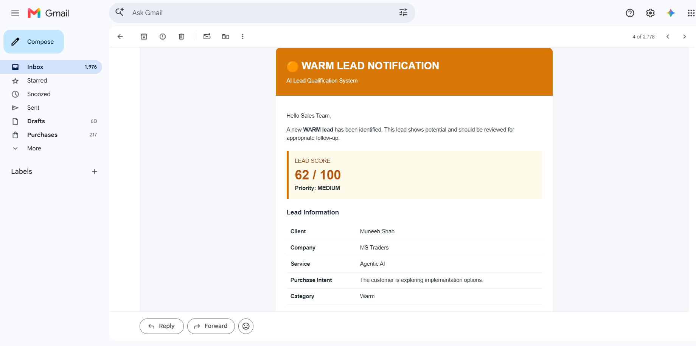

# AI Lead Qualification System

An AI-powered lead qualification and categorization system built using n8n, Google Gemini, Google Sheets, and Gmail.

## Project Overview

The AI Lead Qualification System automates the process of reviewing, validating, analyzing, and categorizing business leads. It uses AI-powered analysis to help organize lead information and streamline follow-up processes.

## Business Problem

Manually reviewing and qualifying leads can consume time, create inconsistent assessments, and delay follow-ups. Businesses need a structured process to validate incoming lead data, prioritize potential customers, and manage lead records efficiently.

## Proposed Solution

This project uses n8n to automate lead processing. It retrieves lead records from Google Sheets, validates the data, analyzes valid leads using Google Gemini, and routes them according to their qualification categories.

## Technologies Used

- **n8n:** Workflow automation and orchestration
- **Google Gemini:** AI-powered lead analysis
- **Google Sheets:** CRM data storage and management
- **Gmail:** Automated email notifications
- **JavaScript:** Data validation and processing
- **JSON:** Structured data exchange
- **APIs and Webhooks:** Workflow integration and triggering

## Key Features

- Automated CRM lead retrieval
- Lead data validation
- AI-powered lead analysis and scoring
- Automated lead categorization
- Category-based workflow routing
- Google Sheets record updates
- Automated email notifications
- Error handling and workflow monitoring

## Workflow Architecture

The main workflow follows these stages:

1. Lead Data Retrieval
2. Data Validation
3. Lead Data Preparation
4. AI-Powered Analysis
5. AI Output Validation
6. Lead Categorization
7. CRM Updates and Email Notifications

A separate Error Handling Workflow is configured in the main workflow's settings to capture execution failures and send automated Gmail notifications.

## Error Handling Workflow

A separate n8n workflow that captures execution failures and sends automated email notifications with error details.

[Download Error Handling Workflow (JSON)](AI-Lead-Qualification-Error-Workflow.json)

## Sample Data Files

- [Sample CRM Input Data](Sample-CRM-Input-Data.csv) — Fictional CRM leads used to test the workflow.
- [Sample CRM Execution Output](Sample-CRM-Execution-Output.csv) — CRM records after workflow execution.

## Email Notifications

### Automated Lead Notifications

- **Hot Lead Notification:** Automated email sent for high-priority leads.
- **Warm Lead Notification:** Automated email sent for potential leads.

### Error Notification

- **Error Notification Email:** Example of an error alert successfully received by email through the separate error-handling workflow.

## Data Processing Notes

- **Invalid Leads:** Lead Score and AI qualification fields remain blank for invalid records because they are excluded from the AI qualification process.
- **Valid Leads:** Follow-up Status is intentionally not updated by the current workflow. Automated follow-up status management is outside the current implementation scope.

These behaviors are intentional and reflect the current workflow design.

## Project Status

Developed and tested as a practical AI automation project using fictional lead data.

## Limitations

- The workflow was developed and tested in a local n8n environment.
- AI-generated scores and categories require human review before business decisions.
- Public live deployment is not currently available.

## Author

**AI Automation & Integration | Management Sciences Undergraduate Student**

## Project Screenshots

### 1. Workflow Overview

### 2. Successful Execution

### 3. CRM Input – Test Data

### 4. CRM Validated Leads Data

### 5. CRM Hot, Warm & Unqualified Leads

### 6. Hot Lead Notification

### 7. Warm Lead Notification

### 8. Error Handling Workflow

### 9. Error Notification Email

## Project Videos

The following videos demonstrate the project presentation, workflow execution, and practical functionality.

1. Project Presentation & Workflow Execution: [Watch Video 1](https://youtu.be/TrbrbRSboZI)
2. Practical Workflow Demonstration: [Watch Video 2](https://youtu.be/4glMDupIduA)
